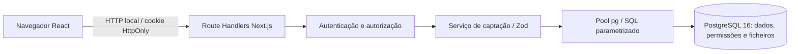
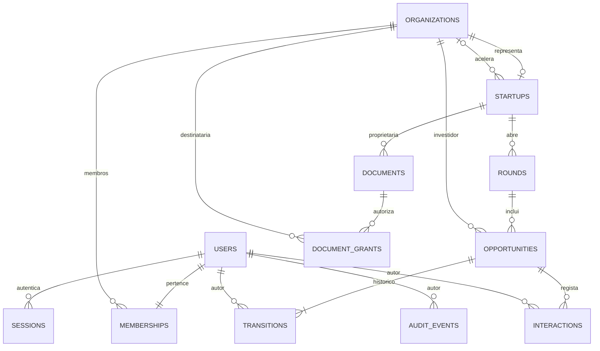
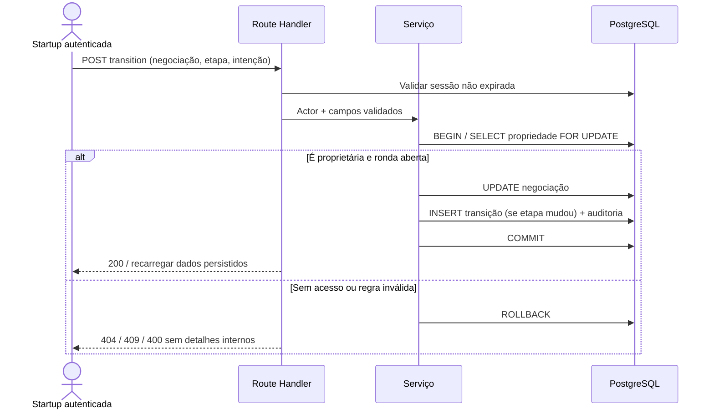

# Arquitetura implementada — SEED

Data da verificação: 7 de outubro de 2026. Monólito modular Next.js 16.2.7, React 19.2.4, TypeScript e PostgreSQL 16.15. Não existia ORM; foi adotado `pg`, SQL parametrizado e migrações SQL versionadas. Não existem pagamentos, compra de participações, assinatura eletrónica ou envio de email.

## Camadas

- `app/workspace/layout.tsx`: autenticação e leitura inicial no servidor. `app/workspace/page.tsx` e `[...path]/page.tsx` selecionam o painel ou a tarefa.
- `components/workspace`: navegação por papel, listas, detalhes e formulários separados; contexto partilhado para atualizar os dados após alterações. Sem credenciais ou acesso direto à BD. O antigo `components/platform/workspace.tsx` é apenas um adaptador.
- `app/api/capture/[[...path]]/route.ts`: transporte HTTP, sessão, verificação de origem, erros públicos e downloads privados.
- `lib/server/auth.ts`: hashes scrypt, sessões opacas de 8 horas, limitação de tentativas por email (10/15 min).
- `lib/server/capture.ts`: validação Zod, propriedade dos recursos, transações, consultas e indicadores.
- `lib/server/db.ts`: pool único por processo, máximo 5 ligações, timeout de ligação 3 s e de instrução 10 s. As regras e as consultas estão num serviço proporcional ao âmbito; não há repositórios genéricos nem microserviços.
- `db/migrations`: esquema versionado, aplicado pelo administrador local dedicado. A aplicação não usa a conta administradora.

## Organização da interface (revisão de 8 de outubro de 2026)

O painel `/workspace` adapta o conteúdo ao papel: próximos passos da startup, oportunidades do investidor ou startups acompanhadas pela aceleradora. Não contém formulários. A raiz pública encaminha sessões existentes para este painel.

| Percurso | Responsabilidade |
|---|---|
| `/workspace/profile` e `/profile/edit` | Consultar ou editar o perfil próprio |
| `/workspace/startups` e `/startups/{id}` | Aceleradora consulta startups vinculadas |
| `/workspace/rounds`, `/rounds/new`, `/rounds/{id}` | Listar, criar ou acompanhar uma ronda |
| `/workspace/opportunities`, `/opportunities/new`, `/opportunities/{id}` | Listar, associar investidor ou consultar negociação |
| `/workspace/opportunities/{id}/edit` | Atualizar etapa, intenção, term sheet e próximo passo |
| `/workspace/opportunities/{id}/interactions` e `/new-interaction` | Consultar ou registar interações |
| `/workspace/opportunities/{id}/history` | Consultar transições |
| `/workspace/documents`, `/documents/new`, `/documents/{id}` | Listar, anexar ou consultar documento |
| `/workspace/documents/{id}/access` e `/delete` | Gerir autorizações ou confirmar eliminação |
| `/workspace/metrics` e `/metrics/{id}` | Escolher ronda e consultar indicadores |

Os caminhos abreviados na tabela conservam o prefixo `/workspace`; os modos de uma entidade conservam também o respetivo identificador. Listas gerais usam pesquisa e paginação de oito registos. A navegação móvel e a lateral partilham os mesmos destinos. Formulários apresentam uma ação principal e cancelamento; feedback de gravação aparece no destino. As restrições visuais complementam as verificações de propriedade e associação no servidor, sem as substituir. A alteração da interface não exige migração de dados.

## Modelo de dados

`login_attempts` guarda o hash do email e a janela de tentativas, sem palavra-passe; `schema_migrations` guarda a versão aplicada. Cada utilizador tem uma organização nesta versão; uma organização pode ter vários membros. O papel deriva de `organizations.kind`; não existem subpapéis de equipa ou superadministrador na interface. As contas e vínculos são provisionados pelo seed demonstrativo.

UUIDs são PK das entidades; tabelas de associação usam PK composta. `email`, organização da startup e par `(round_id, investor_id)` são únicos. As FKs impedem referências órfãs; entidades de negócio usam RESTRICT, sessões são eliminadas com o utilizador e autorizações com o documento. Índices cobrem chaves de consulta por startup, investidor e negociação. Enumerações são CHECKs. Valores `numeric(18,2)` são transmitidos como strings; não se somam moedas. Valores acima de 15 algarismos inteiros são rejeitados pela aplicação (limite conservador). Datas usam `timestamptz`, servidor UTC; interface apresenta Africa/Luanda, e a entrada de data usa o fuso do dispositivo.

As etapas pertencem a `opportunities`, nunca ao investidor global. Transições podem avançar ou recuar para permitir correções, com histórico append-only. Ronda encerrada bloqueia alterações de negociação até reabertura. Interações continuam registáveis, pois podem documentar acompanhamento posterior. Soft commit exige valor positivo; term sheet exige estado explícito. O estado `closed` significa negociação encerrada, não fundos recebidos. O sistema não regista liquidação financeira. O valor de intenção pode ser retirado; o histórico de etapas continua a documentar a passagem, mas não é um livro de alterações de valores/condições.

## Permissões no servidor

| Recurso | Startup proprietária | Investidor | Aceleradora |
|---|---|---|---|
| Perfil e ronda | Consulta/escrita | Consulta se existe negociação sua | Consulta se startup vinculada |
| Negociação e interações | Consulta/escrita | Consulta apenas da sua relação | Consulta de startups vinculadas |
| Documentos | Upload, consulta, descarga, eliminação | Apenas concessão explícita por documento | Apenas concessão explícita por documento |
| Autorizações | Conceder/revogar a investidor associado ou aceleradora vinculada | Sem gestão | Sem gestão |
| Indicadores | Rondas próprias | Apenas relações visíveis; não total da startup | Rondas de startups vinculadas |

Todas as operações de escrita exigem sessão e organização proprietária. Ler metadados de documentos não é permitido apenas por conhecer o UUID. Downloads retornam 404 para recursos inexistentes e não autorizados. Revogação impede novas descargas, mas não remove cópias já obtidas. O isolamento é aplicado no serviço e testado por HTTP; não há RLS PostgreSQL. As contas, aceleradoras e investidores demo são provisionados explicitamente; cadastro público está fora desta entrega.

## Armazenamento e consistência

Conteúdo de PDF/texto UTF-8 até 2 MiB em `documents.content` (`bytea`). Metadados, autorizações e conteúdo são persistentes na mesma base. Esta escolha evita armazenamento público e simplifica o backup transacional do MVP; object storage fica futuro. Não há antivírus, controlo de versões, assinatura digital nem comprovação da autenticidade do conteúdo. Upload verifica tamanho, assinatura inicial de PDF ou texto UTF-8; downloads são anexos com `nosniff`.

Atualização de estado + transição + auditoria, criação de negociação + transição inicial, concessão/revogação e upload decorrem em transações. A linha da negociação é bloqueada durante transições concorrentes. O papel da aplicação não pode alterar/eliminar transições ou auditoria. O histórico regista etapa e autor; não captura todas as revisões de texto.

## Indicadores

Período de cada ronda: `rounds.created_at` até à consulta. Não há filtros de calendário nem taxas agregadas entre moedas. A consulta usa exclusivamente negociações autorizadas. Eventos de origem são `transitions.created_at`, gerados no servidor; datas inseridas nas notas não alteram o cálculo.

| Indicador | Fórmula | Ausência / interpretação |
|---|---|---|
| Negociações | Contagem de oportunidades visíveis da ronda | 0 é calculável se a ronda foi consultada com sucesso |
| Conversão reunião → soft commit | 100 × negociações com evento soft_commit posterior ou simultâneo ao primeiro evento meeting / negociações com evento meeting | Denominador 0: null/Não calculável. Denominador positivo sem conversão: 0%. Cada negociação conta uma vez; recuos e recusas posteriores não apagam a conversão histórica |
| Dias até primeiro soft commit | (menor data de transição soft_commit − abertura da ronda)/86 400 s | Sem evento: null/Não calculável. Não mede tempo desde demo day (não armazenado), nem tempo até recebimento de dinheiro |

A interface apresenta os valores de intenção de cada negociação na moeda da ronda. Não apresenta volume captado, eficácia, impacto ou retorno financeiro.

## Limites da segurança local

A instância só escuta 127.0.0.1:55432, com senha SCRAM para TCP; socket administrativo em `.local` protegido por permissões 0700. A autenticação de socket é trust dentro desse diretório: qualquer processo do mesmo utilizador do SO pode administrá-la. `.env.local` e credenciais demo têm 0600 e estão ignorados pelo Git. HTTP local não fornece TLS; cookies Secure só quando APP_ORIGIN é HTTPS. Não há alegação de prontidão para produção, pentest, conformidade jurídica ou anonimato dos respondentes.

A migração `002_integrity.sql` acrescenta limites de comprimento e triggers que verificam o tipo de organização para startup, aceleradora e investidor. O papel da aplicação só pode alterar o nome da organização, não o seu tipo. O registo de migrações é inacessível à aplicação. As consultas do estado e dos indicadores partilham uma transação `REPEATABLE READ READ ONLY`, evitando misturar instantes diferentes durante alterações concorrentes.
